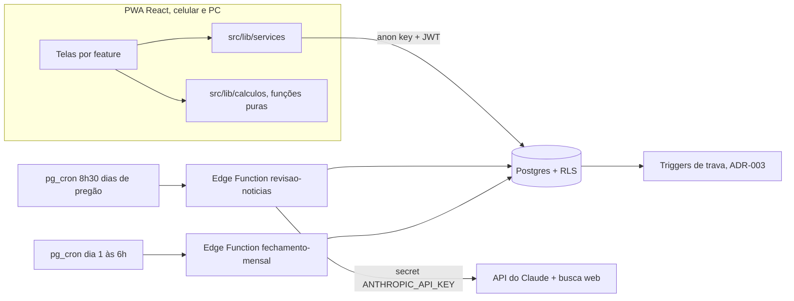

# Arquitetura, Rota do Milhão

Modelo: Supabase direto (default da fundação), com Edge Functions para o que não pode rodar no cliente. Stack em ADR-001.

## Camadas
| Camada | Onde | Responsabilidade |
|---|---|---|
| Telas | `src/features/*` | Interface e estado local |
| Serviços | `src/lib/services/*` | Todo acesso ao Supabase, tratamento de erro |
| Cálculos | `src/lib/calculos/*` | Projeção, limite diário, expectativa, R, IR. Puras, testadas |
| Banco | `supabase/` | Schema, RLS, views, triggers de trava |
| Funções | `supabase/functions/*` | IA, fechamento mensal, importações futuras |

## Features (pastas)
`orcamento`, `lancamentos`, `metas`, `plano`, `patrimonio`, `trade`, `noticias`, `config`.

## Agendamentos
| Job | Quando | Faz |
|---|---|---|
| `revisao-noticias` | 8h30, dias de pregão | ADR-004 |
| `fechamento-mensal` | dia 1, 6h | Pré-preenche o fechamento do mês anterior para o dono confirmar |
| `abrir-dia-trade` | 8h, dias de pregão | Cria o `dia_trade` com capital de início e status `aberto` |

## Fuso horário
Toda regra de data usa America/Sao_Paulo. O banco guarda em UTC, e as views convertem.

## Onde ficam os cálculos
Os cálculos de exibição rodam no cliente (resposta instantânea). As regras que protegem (travas, risco máximo) rodam no banco. Nenhuma trava depende do cliente.
