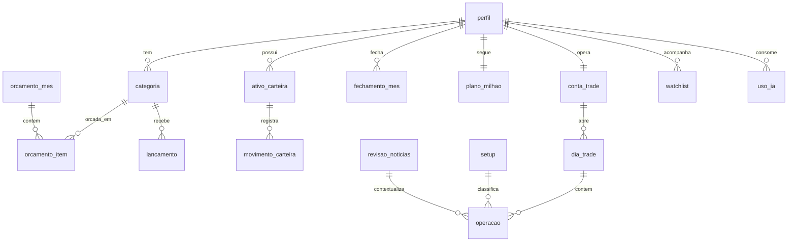

# Modelagem de Dados, Rota do Milhão

Postgres (Supabase). Todo valor em dinheiro é `bigint` em centavos. Toda tabela tem `user_id uuid not null references auth.users` e RLS `user_id = auth.uid()` (ADR-002). Timestamps em `timestamptz`.

## Diagrama

## Entidades

### perfil
`user_id`, `nome`, `data_mudanca date`, `dia_fechamento smallint default 1`, `fuso text default 'America/Sao_Paulo'`.

### categoria
`id`, `nome`, `tipo` (`fixa` | `variavel`), `ativa bool`, `ordem`, `estimativa bool` (O-03).

### orcamento_mes / orcamento_item
- `orcamento_mes`: `id`, `mes date` (dia 1), `renda_prevista_centavos`, `travado_em timestamptz` (O-02).
- `orcamento_item`: `orcamento_mes_id`, `categoria_id`, `valor_centavos`.

### renda
`id`, `mes date`, `fonte` (salário, renda extra, outro), `valor_centavos`, `recebido_em date`.

### lancamento
`id`, `data date`, `categoria_id`, `valor_centavos` (negativo só em estorno), `descricao text null`, `estorno_de uuid null` (O-05), `criado_em`.

### ativo_carteira / movimento_carteira
- `ativo_carteira`: `id`, `nome`, `classe` (`reserva` | `renda_fixa` | `fii` | `acoes` | `capital_trade` | `outro`), `instituicao text`.
- `movimento_carteira`: `id`, `ativo_id`, `data`, `tipo` (`aporte` | `resgate` | `rendimento` | `ajuste_saldo`), `valor_centavos`.
- Saldo do ativo = soma dos movimentos. Nada de campo saldo editável.

### fechamento_mes
`id`, `mes`, `renda_real`, `gasto_real`, `aporte_real`, `patrimonio_real`, `patrimonio_projetado`, `meta_batida bool`, `violacoes_trava int`, `notas text`. Imutável depois de criado; correção gera novo registro com `substitui uuid`.

### plano_milhao
`meta_centavos default 100000000` (R$ 1.000.000), `taxa_real_mensal numeric(6,4) default 0.0045`, `aporte_atual_centavos`, `aporte_pos_mudanca_centavos`, `pct_lucro_trade_para_aporte default 70`.

### conta_trade
`capital_inicial_centavos`, `risco_operacao_centavos`, `stop_gain_r numeric default 2`, `stop_loss_dia_r numeric default 2`, `pct_perda_semana default 3`, `pct_perda_mes default 8`, `etapa_risco smallint default 1`, `ultima_mudanca_risco date`.

### dia_trade
`id`, `data date`, `capital_inicio_centavos`, `status` (`aberto` | `fechado_meta` | `fechado_perda` | `fechado_semana` | `fechado_mes` | `encerrado_manual`), `resultado_liquido_centavos`, `nota_dia text`.
Único por (`user_id`, `data`).

### setup
`id`, `nome` (ex.: FVG de continuação), `descricao`, `ativo bool`.

### operacao
| Campo | Tipo | Regra |
|---|---|---|
| `id`, `dia_trade_id` | uuid | |
| `aberta_em`, `fechada_em` | timestamptz | |
| `ativo` | text | ex.: PETR4F, WINZ26 |
| `mercado` | enum `acoes`, `mini_indice` | |
| `direcao` | enum `compra`, `venda` | |
| `quantidade` | int > 0 | |
| `preco_entrada`, `preco_stop`, `preco_alvo`, `preco_saida` | numeric | |
| `multiplicador` | numeric | 1 em ações, 0,20 no WIN (T-03) |
| `risco_centavos` | bigint | calculado (T-03) |
| `resultado_bruto_centavos`, `custos_centavos`, `resultado_liquido_centavos` | bigint | |
| `resultado_r` | numeric | calculado (T-05) |
| `setup_id` | uuid | T-02 |
| `tendencia_diario`, `tendencia_h1`, `tendencia_h4` | enum `alta`, `baixa`, `lateral` | T-02 |
| `timeframe_entrada` | enum `15s`, `5m`, `15m` | T-02 |
| `teve_noticia` | bool | T-02 |
| `noticia_descricao` | text null | |
| `revisao_noticias_id` | uuid null | IA-05 |
| `seguiu_plano` | bool | |
| `observacao` | text null | |
| `violacao_trava` | bool default false | TR-03 |
| `origem` | enum `manual`, `mt5`, `kora_trader` | Fase 4 |

### apuracao_ir
`mes`, `lucro_liquido_dt`, `prejuizo_acumulado_dt`, `irrf_estimado`, `imposto_devido`, `vencimento date`, `pago bool`.

### watchlist
`id`, `ativo`, `mercado`, `ativa bool`. Máximo 10 ativos ativos (IA-01).

### revisao_noticias
`id`, `data date`, `gerada_em`, `modelo text`, `conteudo jsonb` (por ativo: resumo, impacto esperado, riscos), `agenda jsonb`, `fontes jsonb`, `custo_estimado_centavos`, `status` (`ok` | `sem_orcamento` | `erro`).

### uso_ia
`mes date`, `chamadas int`, `tokens_entrada bigint`, `tokens_saida bigint`, `buscas int`, `custo_estimado_centavos`. Base da trava IA-03.

## Views calculadas
- `v_limite_gasto_hoje` (M-07)
- `v_estatisticas_trade` (T-06)
- `v_status_travas` (TR-01)
- `v_projecao_milhao` (PL-01), calculada no front em função pura com teste, e conferida contra a view.
