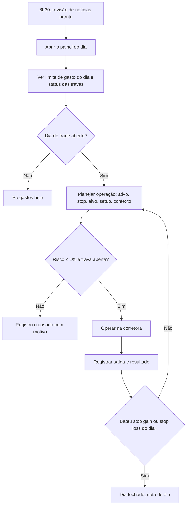

# Fluxos, Rota do Milhão

## Rotina do dia de pregão

## Lançar um gasto (meta: menos de 20 segundos)
1. Botão "+" fixo na tela.
2. Valor (teclado numérico), categoria (as 5 mais usadas no topo), data (hoje por padrão).
3. Salvar. O limite de gasto do dia se atualiza na hora.

## Registrar uma operação
1. Ativo e mercado (ações ou mini-índice). Multiplicador preenchido sozinho.
2. Direção, quantidade, entrada, stop, alvo. O sistema mostra o risco em reais e em % do capital.
3. Contexto: setup, tendências, timeframe, notícia (com atalho para a revisão do dia).
4. Ao sair: preço de saída e custos. Resultado bruto, líquido e em R calculados.
5. Seguiu o plano? Observação.

## Operação com o período fechado (ADR-003)
1. O formulário normal fica bloqueado com o motivo e a hora da reabertura.
2. Existe só a opção "Registrar operação já executada (violação)", com confirmação.
3. A operação entra marcada e vai para o fechamento.

## Operação de um dia passado (T-10, ADR-007)
1. Na tela Trade, tocar no dia no calendário (só segunda a sexta; feriado e dia futuro não aceitam registro).
2. O detalhe mostra o resultado e a trava daquele dia, e as operações já registradas.
3. Dia aberto: "Registrar operação deste dia" pede a hora da entrada, os dados de sempre e já a saída e os custos.
4. Dia fechado pela trava: só "Registrar operação já executada (violação)".
5. A operação aparece como "registrada depois" e muda o resultado da semana e do mês na hora.

## Fechamento mensal (dia 1)
1. O sistema pré-preenche renda, gastos e aportes do mês.
2. O dono confere os saldos da carteira e ajusta o que mudou.
3. Confirma: grava patrimônio real, compara com o projetado, recalcula o prazo do milhão.
4. Mostra: meta batida ou não, categorias que estouraram, violações de trava, IR do trade a pagar.
5. Abre o orçamento do mês novo, copiado do anterior (O-02).

## Revisão anual (janeiro)
1. Patrimônio real × meta anual.
2. Recalcula as metas do ano a partir do real (M-03).
3. Revisa taxa real, aporte e regras de risco. Mudança relevante vira ADR.

## Fase 0 (até a mudança)
Usa o protótipo em artifact: lançar gastos reais e registrar a reserva. Na Fase 1, esses dados são importados manualmente.
